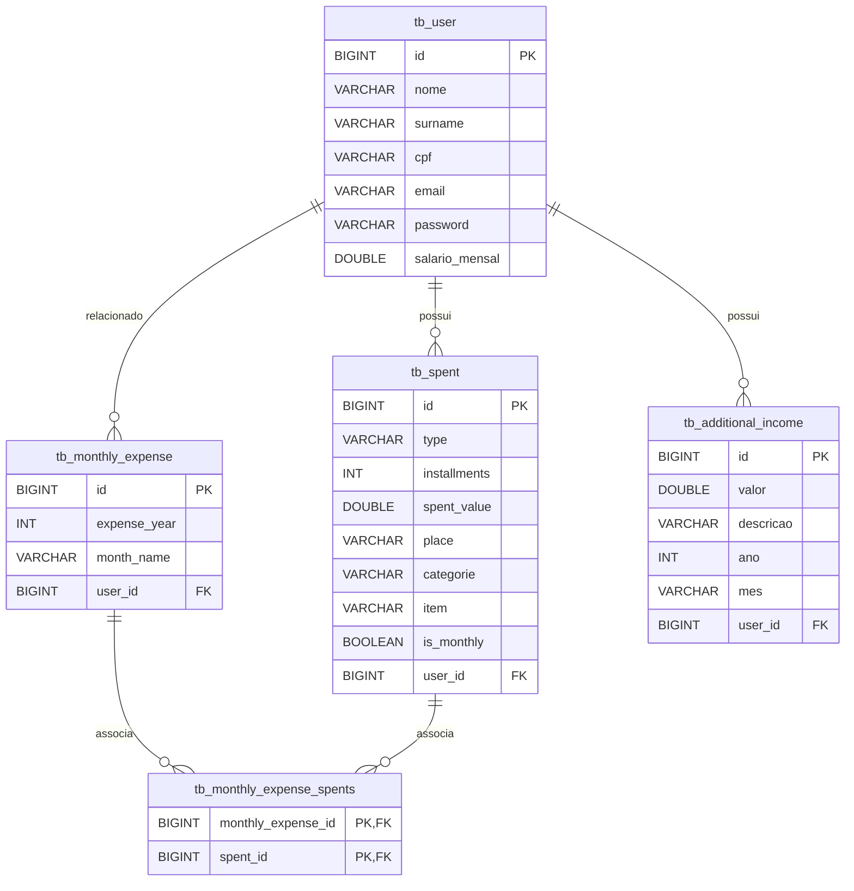

# SmartCash API

API REST para controle financeiro pessoal desenvolvida em **Java 17** e **Spring Boot 3.4.4**, estruturada em **Arquitetura Hexagonal (*Ports & Adapters*)**.

---

## 🧰 Tecnologias Principais

- **Java 17 & Spring Boot 3.4.4** — Spring Web, Spring Data JPA, Bean Validation.
- **Spring Security + JWT (`jjwt 0.12.3`)** — Autenticação *stateless* com *access token* e *refresh token*.
- **H2 Database** — Configurado em runtime no `pom.xml` *(o projeto também possui histórico de scripts SQL para MySQL/Flyway em `src/main/resources/db/migration` e exemplo em `src/main/resources/application-example.properties`)*.
- **Swagger / OpenAPI 3 (`springdoc-openapi`)** — Documentação interativa da API.
- **iText 7** — Geração de relatórios financeiros mensais e completos em PDF.

---

## 📚 Documentação

- [Guia Geral do Projeto (stack, arquitetura e endpoints)](./docs/guia-geral.md)
- [Arquitetura Hexagonal (camadas, portas, adaptadores e wiring)](./docs/arquitetura-hexagonal.md)

---

## 📁 Documentação Interativa da API (Swagger)

Após rodar a aplicação, acesse:

```text
http://localhost:8080/swagger-ui/index.html
```

---

## 🚀 Como executar localmente

1. Crie `src/main/resources/application.properties` a partir de `src/main/resources/application-example.properties` (ajustando para H2 ou adicionando o driver MySQL no `pom.xml` caso utilize MySQL).
2. Compile e execute:

```bash
# Clonar o repositório
git clone https://github.com/Fioshi/java-spring-smartCash.git
cd java-spring-smartCash

# Build / testes do projeto
./mvnw test

# Rodar a aplicação
./mvnw spring-boot:run
```

---

## 🗄️ Modelo de Dados


